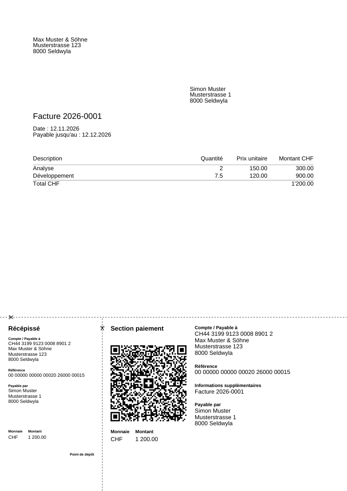
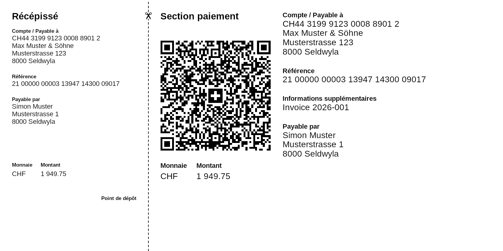

# Facture QR

Invoicing with Swiss QR-bills for independents, in .NET.

A QR-bill is the only payment slip accepted in Switzerland and Liechtenstein since 30 September 2022. Producing one correctly means following the SIX Implementation Guidelines: structured addresses, a QR-IBAN with a QR reference or an IBAN with an ISO 11649 Creditor Reference, a precise 31-line payload inside the Swiss QR Code, and a fixed 210 × 105 mm layout. This repository is being built in small, verified steps, starting with that core.

**Status:** third unit (B2) in progress. The repository contains the QR-bill core library (B0), the invoice model with its storage in PostgreSQL (B1), an HTTP API that drives the whole invoice flow and serves the invoice as a PDF with its QR-bill (B2), their tests, synthetic samples and the quality baseline (build with warnings as errors, formatting check, continuous integration). The QR-bill samples pass the library's validation, a round trip through the decoder and an independent QR decoder; validation in the SIX portal is still pending. There is no user interface yet. The planned next steps are listed at the end.

A French summary follows the English text ([Résumé en français](#résumé-en-français)).

## What the core does today

`src/FactureQr.Core` is a small library with no infrastructure dependencies. The QR-bill part (`Billing/`):

| Type | Responsibility |
|---|---|
| `Iban` | Swiss or Liechtenstein IBAN (21 characters, modulo 97 check) and QR-IBAN detection (QR-IID 30000–31999). |
| `StructuredAddress` | Name, street, building number, postal code, town, country, with the lengths and the character set of the standard. Combined address lines are not accepted (mandatory since 22 November 2025). |
| `PaymentReference` | QR reference (27 digits, modulo 10 recursive check digit), Creditor Reference (ISO 11649, modulo 97-10 check digits) or none; creation and validation of both. |
| `QrBillRequest` | One payment part in CHF: creditor, account, optional amount, optional debtor, reference, optional message, with the rules that tie them together (a QR-IBAN requires a QR reference; a plain IBAN excludes it; CHF only). |
| `QrBillRenderer` | Validates a request, then produces the Swiss QR Code text, the payment part with receipt as PDF or PNG (French headings), or the QR code alone as PNG; decodes QR code text back into a request. |

Rendering uses [SwissQRBill.NET](https://github.com/manuelbl/SwissQRBill.NET) (MIT) behind a single class; see [ADR-0002](docs/adr/0002-qr-bill-library.md).

The invoice model (`Invoicing/`):

| Type | Responsibility |
|---|---|
| `Customer` | A customer with a structured address, limited to the characters the invoice PDF can print (the QR-bill character set also allows `ÿ`, which the font of the PDF lacks). |
| `Invoice` | An invoice in CHF to one customer, with its lines. States `Draft` → `Issued` → `Paid`; only a draft can change. The total is always the sum of the lines and stays within the QR-bill range (at most 999 999 999.99 CHF; at least 0.01 CHF to be issued). Issuing sets the number, the issue date and the due date. The customer's address is copied onto the invoice, so issued invoices do not change when the customer moves. Overdue is derived from the due date, not stored. |
| `InvoiceLine` | Description, quantity (up to three decimals), unit price; amount = quantity × unit price rounded to the centime. The description is limited to the characters the PDF can print; typographic apostrophes, quotes and dashes are replaced by plain ones. |
| `InvoiceNumber` | Year of the issue date and a sequence that restarts every year, printed as `2026-0001`. |
| `InvoicePayment` | The QR-bill of an issued invoice: the creditor's account, the total, the address on the invoice as debtor, a reference made from the invoice number (QR reference with a QR-IBAN, Creditor Reference with an IBAN) and the message `Facture 2026-0001`. |
| `InvoicePdf` | The invoice as a one-page A4 PDF in French, with the payment part across the bottom 105 mm. |

## Storage

`src/FactureQr.Persistence` stores the model in PostgreSQL with EF Core 10 (Npgsql). The schema is created only by the migrations in `Migrations/`. `InvoiceIssuer` issues a draft in one transaction: it takes the next number of the year from a counter row that stays locked until the transaction ends, so two invoices issued at the same moment never get the same number, and a failed issue rolls the counter back (no gaps). The database repeats the critical rules with check constraints and a unique index on the number. The reasons for these choices are in [ADR-0003](docs/adr/0003-invoice-persistence-and-numbering.md).

To create the schema in a database of your own:

```sh
dotnet tool restore
FACTUREQR_DATABASE="Host=localhost;Database=facture_qr;Username=postgres;Password=..." \
  dotnet ef database update --project src/FactureQr.Persistence
```

## HTTP API

`src/FactureQr.Api` exposes the model with ASP.NET Core Minimal APIs:

| Endpoint | Purpose |
|---|---|
| `POST /customers`, `GET /customers`, `GET /customers/{id}` | Customers with a structured address |
| `POST /invoices`, `GET /invoices`, `GET /invoices/{id}` | Drafts with their lines; the list with the state and whether each invoice is overdue |
| `POST /invoices/{id}/lines`, `DELETE /invoices/{id}/lines/{lineId}` | Edit a draft |
| `POST /invoices/{id}/issue` | Issue: next number of the year, issue date (today by default) and due date (30 days later by default) |
| `POST /invoices/{id}/mark-paid` | Record the payment |
| `GET /invoices/{id}/pdf` | The invoice with its QR-bill, `application/pdf` |
| `GET /health`, `GET /openapi/v1.json` | Health (checks the database) and the OpenAPI document |

Errors are ProblemDetails: 400 when the request itself is invalid (with the field named), 404 when the resource in the URL does not exist, 409 when the state of the invoice does not allow the request (for example editing an issued invoice). Logs are JSON lines, without names or addresses. The OpenAPI document is also committed as [`docs/api/openapi.json`](docs/api/openapi.json). The reasons for these choices are in [ADR-0004](docs/adr/0004-http-api.md); example calls and their responses are in [`docs/validation/B2.md`](docs/validation/B2.md).

The creditor (name, structured address, IBAN or QR-IBAN) comes from the `Invoicing` configuration section and is checked when the API starts. `appsettings.Development.json` contains the synthetic creditor of the samples. To run the API against a database created as described above:

```sh
ASPNETCORE_ENVIRONMENT=Development \
ConnectionStrings__FactureQr="Host=localhost;Database=facture_qr;Username=postgres;Password=..." \
  dotnet run --project src/FactureQr.Api
```

The API has no authentication: it is meant to run locally for one person and must not be exposed on a network as it is.



## Samples

Three synthetic bills, one per reference variant, are under [`docs/samples`](docs/samples): the PDF, a PNG preview, the QR code alone (`.qr.png`) and the QR code text (`.qr.txt`). All names, addresses and accounts come from the examples in Annex A of the SIX Implementation Guidelines and are fictitious. Each sample passes the library's validation, the round trip through the decoder and an independent QR decoder; their validation in the SIX portal is pending (see `docs/validation/B0.md`).

| Sample | Account | Reference |
|---|---|---|
| a | QR-IBAN | QR reference (QRR) |
| b | IBAN | Creditor Reference (SCOR) |
| c | IBAN | none |

`invoice-2026-0001.pdf` (with its preview `invoice-2026-0001.png`) is an invoice produced by the API with the same synthetic data, as recorded in `docs/validation/B2.md`.



## Build and test

Requirements: .NET SDK 10 (see `global.json`) and Docker for the storage and API tests, which start a disposable PostgreSQL with [Testcontainers](https://dotnet.testcontainers.org/). On Linux, PNG rendering also needs the SkiaSharp native library, which the test and tool projects reference as a NuGet package.

```sh
dotnet restore
dotnet build --configuration Release -warnaserror
dotnet format --verify-no-changes
dotnet test --configuration Release
```

To regenerate the sample files:

```sh
dotnet run --project tools/FactureQr.Samples -- docs/samples
```

The same four commands run in GitHub Actions on every push and pull request (`.github/workflows/ci.yml`), together with `dotnet ef database update` on an empty PostgreSQL database.

## How correctness is checked

The standard is regulated and SIX offers no quality check of its own, so the repository keeps its evidence:

- [`docs/validation/B0-norma.md`](docs/validation/B0-norma.md): the version of the Implementation Guidelines in force, the Style Guide, the library's compatibility and the available validation methods, each with source, URL and reading date.
- [`docs/validation/B0.md`](docs/validation/B0.md): the commands run, their results, the independent checks (golden payloads written by hand from the standard, round trip through the decoder, a second QR decoder, geometry of the rendered payment part against the Style Guide) and the protocol for the SIX validation portal.
- [`docs/validation/B1.md`](docs/validation/B1.md): the commands and results of the invoice model and its storage.
- [`docs/validation/B2.md`](docs/validation/B2.md): the acceptance criteria of the API, the commands and results, example calls and a second decoding of the invoice PDF's QR code.
- Tests of the QR-bill core: `PaymentReferenceTests`, `StructuredAddressTests`, `IbanTests`, `QrBillRequestTests`, `CurrencyRuleTests`, `QrPayloadGoldenTests`, `RoundTripTests`, `RenderingSmokeTests`.
- Tests of the invoice model: `InvoiceTests`, `InvoiceNumberTests` (unit tests of the rules); `MigrationTests`, `InvoiceStorageTests`, `ConcurrencyTests` (against PostgreSQL).
- Tests of the API (`tests/FactureQr.Api.Tests`): the API runs in memory against PostgreSQL started by Testcontainers; `CustomerApiTests`, `InvoiceApiTests` (200/201/400/404/409, numbering through the API), `InvoicePdfApiTests` (the QR code is read back from the drawing in the PDF by an independent decoder and compared with the invoice), `InfrastructureTests` (health, start-up check, OpenAPI). `InvoicePaymentTests` covers the reference made from the invoice number.

## Design decisions

- [ADR-0001: Scope of the first unit and non-goals](docs/adr/0001-scope-and-non-goals.md) (CHF only, no VAT, no application yet).
- [ADR-0002: Use SwissQRBill.NET to render the payment part](docs/adr/0002-qr-bill-library.md).
- [ADR-0003: Invoice model, PostgreSQL with EF Core, and yearly numbering](docs/adr/0003-invoice-persistence-and-numbering.md).
- [ADR-0004: HTTP API, error responses and the invoice PDF](docs/adr/0004-http-api.md).

## Planned next steps

1. A React front end served by the API, and a `docker compose` demo.
2. Import of camt.054 bank statements and automatic reconciliation by reference.

Nothing here is a commitment to dates; each step is delivered when it is verified.

## Licence

MIT, see [`LICENSE`](LICENSE). Third-party licences are listed in [`THIRD-PARTY-NOTICES.md`](THIRD-PARTY-NOTICES.md).

---

## Résumé en français

**Facture QR** est un outil de facturation avec QR-facture pour les indépendants en Suisse, écrit en .NET. La QR-facture est le seul bulletin de versement accepté en Suisse et au Liechtenstein depuis le 30 septembre 2022 ; la produire correctement suppose de respecter les Implementation Guidelines de SIX (adresse structurée, QR-IBAN avec référence QR ou IBAN avec référence de créancier ISO 11649, charge utile de 31 lignes dans le Swiss QR Code, mise en page fixe de 210 × 105 mm).

**État :** troisième unité (B2) en cours. Le dépôt contient la bibliothèque de base (`FactureQr.Core`), le modèle de facture et son stockage dans PostgreSQL (`FactureQr.Persistence`), une API HTTP (`FactureQr.Api`) qui couvre tout le parcours d'une facture et fournit la facture en PDF avec sa QR-facture, leurs tests, des exemples synthétiques et la base de qualité (compilation avec avertissements traités comme des erreurs, vérification du formatage, intégration continue). Les exemples passent la validation de la bibliothèque, un aller-retour par le décodeur et un décodeur QR indépendant ; la validation sur le portail SIX est encore en attente. Il n'y a pas encore d'interface. Les étapes suivantes sont l'interface React avec une démo `docker compose`, puis l'import des relevés camt.054 pour le rapprochement automatique des paiements.

**Modèle de facture :** une facture passe de brouillon à émise puis payée ; seul un brouillon peut changer. Le total est toujours la somme des lignes et reste dans les limites de la QR-facture. La numérotation est annuelle (`2026-0001`) et unique même lorsque deux factures sont émises au même moment ; les raisons de ces choix sont dans l'ADR-0003.

**API :** clients, brouillons avec leurs lignes, émission, paiement, liste avec l'état et le retard, et `GET /invoices/{id}/pdf` qui renvoie la facture A4 en français avec la section paiement. Les erreurs suivent le format ProblemDetails : 400 pour une requête invalide, 404 pour une ressource inconnue, 409 lorsque l'état de la facture ne permet pas l'opération. Le créancier est lu dans la configuration et vérifié au démarrage. L'API n'a pas d'authentification : elle est prévue pour un usage local par une seule personne. Les choix sont expliqués dans l'ADR-0004.

**Vérification :** la version en vigueur de la norme, la compatibilité de la bibliothèque et les méthodes de validation sont consignées dans `docs/validation/B0-norma.md` ; les commandes exécutées, leurs résultats et le protocole du portail de validation SIX sont dans `docs/validation/B0.md`. Seule la devise CHF est acceptée dans cette version (ADR-0001). Toutes les données d'exemple sont fictives et proviennent de l'annexe A des Implementation Guidelines.

**Compiler et tester :** SDK .NET 10 et Docker (pour les tests de stockage et de l'API), puis `dotnet build --configuration Release -warnaserror`, `dotnet format --verify-no-changes` et `dotnet test --configuration Release`. Licence MIT.
