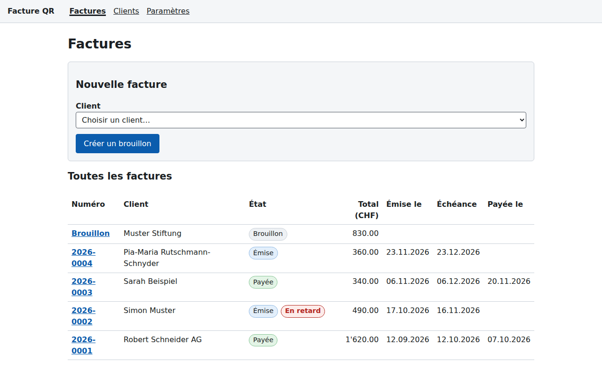
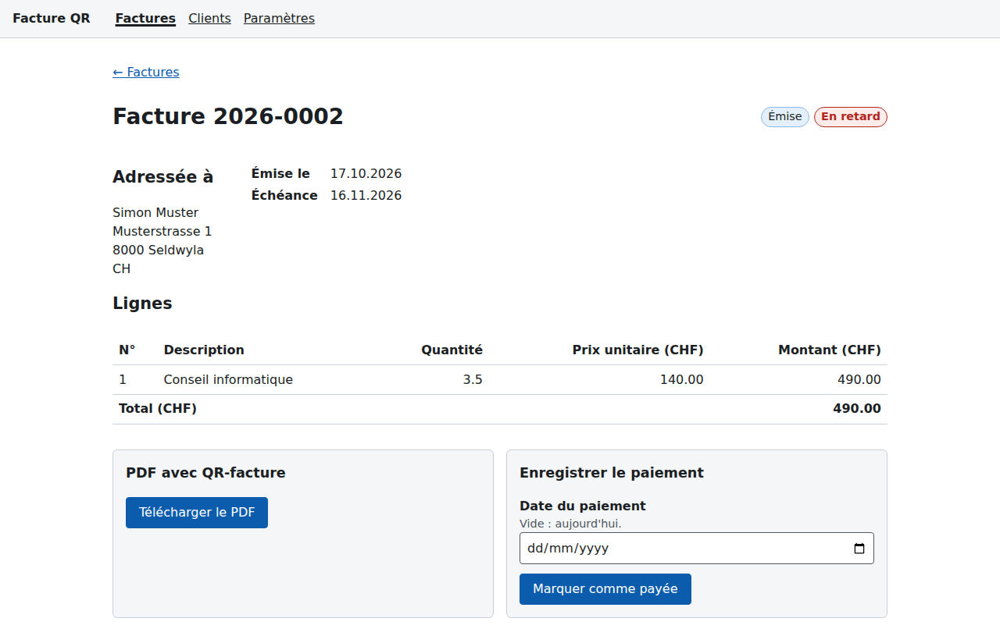
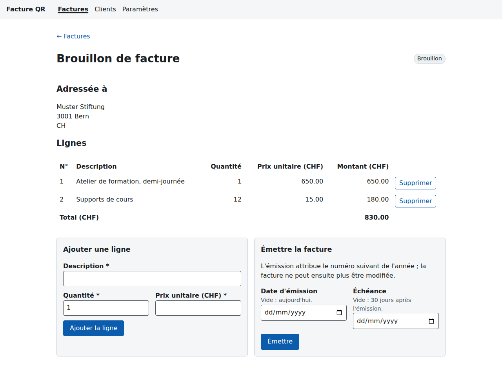
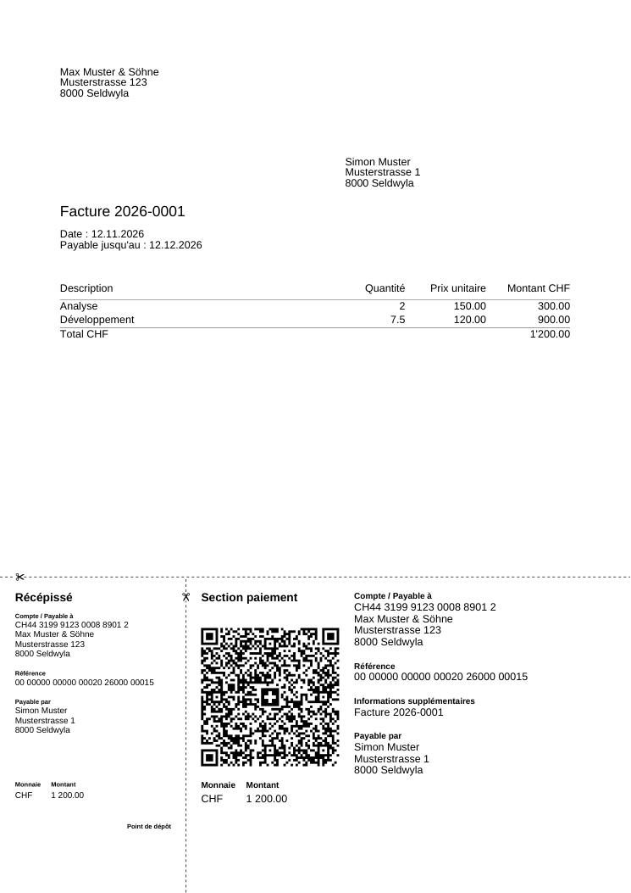
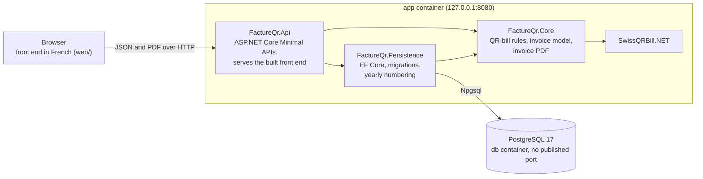
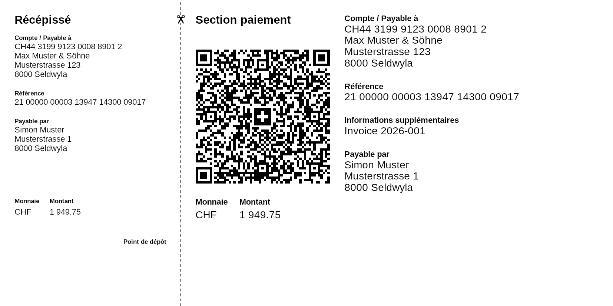

# Facture QR

Invoicing with Swiss QR-bills for independents, in .NET.

A QR-bill is the only payment slip accepted in Switzerland and Liechtenstein since 30 September 2022. Producing one correctly means following the SIX Implementation Guidelines: structured addresses, a QR-IBAN with a QR reference or an IBAN with an ISO 11649 Creditor Reference, a precise 31-line payload inside the Swiss QR Code, and a fixed 210 × 105 mm layout. Facture QR keeps customers and invoices in CHF, numbers them per year, and produces each invoice as a PDF with its QR-bill, from a French web interface.

**Status:** v0.1.0, the first release ([changelog](CHANGELOG.md)). Units B0 to B4 are done: the QR-bill core library, the invoice model with its storage in PostgreSQL, the HTTP API with the invoice PDF, the React front end in French and a Docker Compose demo with synthetic data. The QR-bills pass the library's validation, a round trip through the decoder and an independent QR decoder; their validation in the SIX portal is still pending. The application is meant for one person on their own computer: it has **no authentication** and must not be exposed on a network (see [Security](#security)).

A French summary follows the English text ([Résumé en français](#résumé-en-français)).

## Quick start

Requirements: Git and Docker with Docker Compose v2. Nothing else is installed on the computer: the image builds the front end and the API itself.

```sh
git clone https://github.com/rodbrice/facture-qr.git
cd facture-qr
docker compose up --build
```

The first build downloads the .NET and Node.js images and takes a few minutes. When the log shows `Now listening on: http://[::]:8080`, open <http://localhost:8080>. The API has applied the migrations to an empty PostgreSQL database and added synthetic data: five customers and five invoices, one draft, one issued, one issued and overdue, and two paid. From there, every step of the flow works in the browser: create a customer or a draft, add lines, issue it, download the PDF with its QR-bill, record the payment.

- Port 8080 already in use: `FACTUREQR_PORT=8081 docker compose up --build`, then open <http://localhost:8081>.
- Stop: `Ctrl+C`, or `docker compose down` from another terminal. The data stays in the `db-data` volume and is there at the next start; the synthetic data is added only to an empty database.
- Start again from scratch: `docker compose down --volumes`, then `docker compose up`.

The demo uses the synthetic creditor of the samples (`Max Muster & Söhne`, QR-IBAN `CH44 3199 9123 0008 8901 2`), set in `docker-compose.yml`. How the demo is built and why is in [ADR-0006](docs/adr/0006-docker-compose-demo.md).

## Screenshots

All data in the screenshots is the synthetic data of the demo.

The list of invoices, with their state and the overdue flag:



An issued invoice past its due date, with the PDF download and the payment form:



A draft: its lines can still change before it is issued:



The PDF of an invoice, with the payment part across the bottom 105 mm:



## Architecture



- `src/FactureQr.Core` holds every rule and has no infrastructure dependency: the QR-bill (IBAN, structured address, references, payload, payment part), the invoice and its states, the numbering format and the invoice PDF.
- `src/FactureQr.Persistence` stores the model in PostgreSQL. The schema is created only by its migrations; issuing allocates the next number of the year in the same transaction.
- `src/FactureQr.Api` exposes the model over HTTP, returns errors as ProblemDetails and serves the front end built from `web/`. The rules stay in the domain; the front end shows the API's answers.

## Security

### Threat model

Facture QR v0.1 is a local application for one person. What it holds: the names and addresses of the customers, the invoices and the creditor's IBAN.

| Threat | What v0.1 does | What it does not do |
|---|---|---|
| Another computer reaches the application | The demo publishes the application on `127.0.0.1` only, and the database on no port at all. | No authentication, no TLS. **Do not expose it on a network** (another binding, a reverse proxy, a cloud host) without adding authentication first. |
| A web page open in the same browser changes data (cross-site request) | Requests that change data are refused with 403 when the browser reports another site as their origin (`Sec-Fetch-Site`); the API sends no CORS headers, so another site cannot read the answers. ([ADR-0007](docs/adr/0007-local-api-browser-protections.md)) | Browsers too old to send `Sec-Fetch-Site` are not covered. |
| A web page reaches the API through its own host name (DNS rebinding) | Only `localhost`, `127.0.0.1` and `[::1]` are accepted as host names (`AllowedHosts`). | — |
| Invalid or malicious input | Every request is validated by the domain rules (QR-bill character set and lengths, amounts, dates); the database repeats the critical rules as constraints; EF Core sends parameterised SQL. | — |
| Personal data in logs | Logs contain identifiers and invoice numbers, never names, addresses or request bodies. | — |
| Another program or user on the same computer | — | Any local program can call the API and read the database volume. The demo's database password is a fixed demo value. |
| Vulnerable dependencies | Dependabot proposes version updates every week; CodeQL analyses the C# and TypeScript code on every push, pull request and every week. | No container image scanning. |

## What it does

### QR-bill core

`src/FactureQr.Core/Billing`:

| Type | Responsibility |
|---|---|
| `Iban` | Swiss or Liechtenstein IBAN (21 characters, modulo 97 check) and QR-IBAN detection (QR-IID 30000–31999). |
| `StructuredAddress` | Name, street, building number, postal code, town, country, with the lengths and the character set of the standard. Combined address lines are not accepted (mandatory since 22 November 2025). |
| `PaymentReference` | QR reference (27 digits, modulo 10 recursive check digit), Creditor Reference (ISO 11649, modulo 97-10 check digits) or none; creation and validation of both. |
| `QrBillRequest` | One payment part in CHF: creditor, account, optional amount, optional debtor, reference, optional message, with the rules that tie them together (a QR-IBAN requires a QR reference; a plain IBAN excludes it; CHF only). |
| `QrBillRenderer` | Validates a request, then produces the Swiss QR Code text, the payment part with receipt as PDF or PNG (French headings), or the QR code alone as PNG; decodes QR code text back into a request. |

Rendering uses [SwissQRBill.NET](https://github.com/manuelbl/SwissQRBill.NET) (MIT) behind a single class; see [ADR-0002](docs/adr/0002-qr-bill-library.md).

### Invoice model

`src/FactureQr.Core/Invoicing`:

| Type | Responsibility |
|---|---|
| `Customer` | A customer with a structured address, limited to the characters the invoice PDF can print (the QR-bill character set also allows `ÿ`, which the font of the PDF lacks). |
| `Invoice` | An invoice in CHF to one customer, with its lines. States `Draft` → `Issued` → `Paid`; only a draft can change. The total is always the sum of the lines and stays within the QR-bill range (at most 999 999 999.99 CHF; at least 0.01 CHF to be issued). Issuing sets the number, the issue date and the due date. The customer's address is copied onto the invoice, so issued invoices do not change when the customer moves. Overdue is derived from the due date, not stored. |
| `InvoiceLine` | Description, quantity (up to three decimals), unit price; amount = quantity × unit price rounded to the centime. The description is limited to the characters the PDF can print; typographic apostrophes, quotes and dashes are replaced by plain ones. |
| `InvoiceNumber` | Year of the issue date and a sequence that restarts every year, printed as `2026-0001`. |
| `InvoicePayment` | The QR-bill of an issued invoice: the creditor's account, the total, the address on the invoice as debtor, a reference made from the invoice number (QR reference with a QR-IBAN, Creditor Reference with an IBAN) and the message `Facture 2026-0001`. |
| `InvoicePdf` | The invoice as a one-page A4 PDF in French, with the payment part across the bottom 105 mm. |

### Storage

`src/FactureQr.Persistence` stores the model in PostgreSQL with EF Core 10 (Npgsql). The schema is created only by the migrations in `Migrations/`. `InvoiceIssuer` issues a draft in one transaction: it takes the next number of the year from a counter row that stays locked until the transaction ends, so two invoices issued at the same moment never get the same number, and a failed issue rolls the counter back (no gaps). The database repeats the critical rules with check constraints and a unique index on the number. The reasons for these choices are in [ADR-0003](docs/adr/0003-invoice-persistence-and-numbering.md).

### HTTP API

`src/FactureQr.Api` exposes the model with ASP.NET Core Minimal APIs:

| Endpoint | Purpose |
|---|---|
| `POST /customers`, `GET /customers`, `GET /customers/{id}`, `PUT /customers/{id}` | Customers with a structured address |
| `POST /invoices`, `GET /invoices`, `GET /invoices/{id}` | Drafts with their lines; the list with the state and whether each invoice is overdue |
| `POST /invoices/{id}/lines`, `DELETE /invoices/{id}/lines/{lineId}` | Edit a draft |
| `POST /invoices/{id}/issue` | Issue: next number of the year, issue date (today by default) and due date (30 days later by default) |
| `POST /invoices/{id}/mark-paid` | Record the payment |
| `GET /invoices/{id}/pdf` | The invoice with its QR-bill, `application/pdf` |
| `GET /settings/creditor` | The creditor of the configuration (read-only) |
| `GET /health`, `GET /openapi/v1.json` | Health (checks the database) and the OpenAPI document |

Errors are ProblemDetails: 400 when the request itself is invalid (with the field named), 403 when a browser sends a change from another site, 404 when the resource in the URL does not exist, 409 when the state of the invoice does not allow the request (for example editing an issued invoice). Logs are JSON lines, without names or addresses. The OpenAPI document is also committed as [`docs/api/openapi.json`](docs/api/openapi.json). The reasons for these choices are in [ADR-0004](docs/adr/0004-http-api.md); example calls and their responses are in [`docs/validation/B2.md`](docs/validation/B2.md).

The creditor (name, structured address, IBAN or QR-IBAN) comes from the `Invoicing` configuration section and is checked when the API starts. Two optional settings, used by the Docker Compose demo, act on the database at start: `Database:ApplyMigrations` applies the pending migrations and `Demo:SeedSyntheticData` adds the synthetic data to an empty database (ADR-0006).

### Front end

`web/` is a React and TypeScript application, in French, that drives the whole flow from a browser: customers (list, create, edit), the list of invoices with their state and an *en retard* flag, the editor of a draft (lines, issue), the PDF download, the payment and a settings page that shows the creditor of the configuration. Each refused request is shown next to the field or the action it concerns; the rules themselves stay in the API. The reasons for these choices are in [ADR-0005](docs/adr/0005-front-end.md).

## Development

Requirements: .NET SDK 10 (see `global.json`), Node.js 22 for the front end, and Docker for the storage and API tests, which start a disposable PostgreSQL with [Testcontainers](https://dotnet.testcontainers.org/). On Linux, PNG rendering also needs the SkiaSharp native library, which the test and tool projects reference as a NuGet package.

### Run without Docker Compose

Create the schema in a PostgreSQL database of your own, then start the API in the Development environment, which uses the synthetic creditor of `appsettings.Development.json`:

```sh
dotnet tool restore
FACTUREQR_DATABASE="Host=localhost;Database=facture_qr;Username=postgres;Password=..." \
  dotnet ef database update --project src/FactureQr.Persistence

ASPNETCORE_ENVIRONMENT=Development \
ConnectionStrings__FactureQr="Host=localhost;Database=facture_qr;Username=postgres;Password=..." \
  dotnet run --project src/FactureQr.Api
```

To have the API serve the front end, build it first:

```sh
cd web
npm ci
npm run build    # writes src/FactureQr.Api/wwwroot
```

Then open the address `dotnet run` prints (`http://localhost:5000` by default). To work on the front end, start the API on port 5080 (`ASPNETCORE_URLS=http://127.0.0.1:5080`) and run `npm run dev` in `web/`: the Vite server forwards the API paths to it.

### Build and test

```sh
dotnet restore
dotnet build --configuration Release -warnaserror
dotnet format --verify-no-changes
dotnet test --configuration Release
```

The front end, from `web/`:

```sh
npm ci
npm run lint
npm run typecheck
npm test              # Vitest
npm run build
npx playwright install chromium
npm run e2e           # Playwright: starts the API with dotnet run
```

The end-to-end test needs a PostgreSQL database with the migrations applied (see [Run without Docker Compose](#run-without-docker-compose)); it uses the connection string of `appsettings.Development.json` unless `ConnectionStrings__FactureQr` is set.

To regenerate the sample files:

```sh
dotnet run --project tools/FactureQr.Samples -- docs/samples
```

### Continuous integration

GitHub Actions runs on every push and pull request:

- `.github/workflows/ci.yml`: the build with warnings as errors, the formatting check, the migrations on an empty PostgreSQL database, all the .NET tests, the end-to-end test on that database (its video is kept as an artifact of the run), the lint, type check, unit tests and build of the front end, and the Docker Compose demo, started and checked for its synthetic data.
- `.github/workflows/codeql.yml`: CodeQL analysis of the C# and TypeScript code, also every week.
- `.github/dependabot.yml`: weekly version updates for NuGet, npm, GitHub Actions and the Docker images.

## Samples

Three synthetic bills, one per reference variant, are under [`docs/samples`](docs/samples): the PDF, a PNG preview, the QR code alone (`.qr.png`) and the QR code text (`.qr.txt`). All names, addresses and accounts come from the examples in Annex A of the SIX Implementation Guidelines and are fictitious. Each sample passes the library's validation, the round trip through the decoder and an independent QR decoder; their validation in the SIX portal is pending (see `docs/validation/B0.md`).

| Sample | Account | Reference |
|---|---|---|
| a | QR-IBAN | QR reference (QRR) |
| b | IBAN | Creditor Reference (SCOR) |
| c | IBAN | none |

`invoice-2026-0001.pdf` (with its preview `invoice-2026-0001.png`) is an invoice produced by the API with the same synthetic data, as recorded in `docs/validation/B2.md`.



## How correctness is checked

The standard is regulated and SIX offers no quality check of its own, so the repository keeps its evidence:

- [`docs/validation/B0-norma.md`](docs/validation/B0-norma.md): the version of the Implementation Guidelines in force, the Style Guide, the library's compatibility and the available validation methods, each with source, URL and reading date.
- [`docs/validation/B0.md`](docs/validation/B0.md): the commands run, their results, the independent checks (golden payloads written by hand from the standard, round trip through the decoder, a second QR decoder, geometry of the rendered payment part against the Style Guide) and the protocol for the SIX validation portal.
- [`docs/validation/B1.md`](docs/validation/B1.md): the commands and results of the invoice model and its storage.
- [`docs/validation/B2.md`](docs/validation/B2.md): the acceptance criteria of the API, the commands and results, example calls and a second decoding of the invoice PDF's QR code.
- [`docs/validation/B3.md`](docs/validation/B3.md): the acceptance criteria of the front end, the commands and results.
- [`docs/validation/B4.md`](docs/validation/B4.md): the Docker Compose demo run from a fresh clone, the security tooling, the history check and the release notes of v0.1.0.
- Tests of the QR-bill core: `PaymentReferenceTests`, `StructuredAddressTests`, `IbanTests`, `QrBillRequestTests`, `CurrencyRuleTests`, `QrPayloadGoldenTests`, `RoundTripTests`, `RenderingSmokeTests`.
- Tests of the invoice model: `InvoiceTests`, `InvoiceNumberTests` (unit tests of the rules); `MigrationTests`, `InvoiceStorageTests`, `ConcurrencyTests` (against PostgreSQL).
- Tests of the API (`tests/FactureQr.Api.Tests`): the API runs in memory against PostgreSQL started by Testcontainers; `CustomerApiTests`, `InvoiceApiTests` (200/201/400/404/409, numbering through the API), `InvoicePdfApiTests` (the QR code is read back from the drawing in the PDF by an independent decoder and compared with the invoice), `SettingsApiTests`, `InfrastructureTests` (health, start-up check, OpenAPI, the pages of the front end), `DatabaseStartupTests` (migrations and synthetic data at start), `BrowserRequestTests` (cross-site requests, host names). `InvoicePaymentTests` covers the reference made from the invoice number.
- Tests of the front end (`web/`): Vitest for the forms, the pages of the invoice list and of one invoice, the error mapping and the formatting (`src/**/*.test.ts(x)`); Playwright for the whole flow and keyboard use against the API and PostgreSQL (`e2e/`).

## Design decisions

- [ADR-0001: Scope of the first unit and non-goals](docs/adr/0001-scope-and-non-goals.md) (CHF only, no VAT).
- [ADR-0002: Use SwissQRBill.NET to render the payment part](docs/adr/0002-qr-bill-library.md).
- [ADR-0003: Invoice model, PostgreSQL with EF Core, and yearly numbering](docs/adr/0003-invoice-persistence-and-numbering.md).
- [ADR-0004: HTTP API, error responses and the invoice PDF](docs/adr/0004-http-api.md).
- [ADR-0005: React front end served by the API](docs/adr/0005-front-end.md).
- [ADR-0006: Docker Compose demo with migrations and synthetic data at start](docs/adr/0006-docker-compose-demo.md).
- [ADR-0007: Protections of a local API without authentication](docs/adr/0007-local-api-browser-protections.md).

## Planned next steps

1. v0.2: import of camt.054 bank statements and automatic reconciliation of payments by reference.
2. Validation of the QR-bills in the SIX portal.

Nothing here is a commitment to dates; each step is delivered when it is verified.

## Licence

MIT, see [`LICENSE`](LICENSE). Third-party licences are listed in [`THIRD-PARTY-NOTICES.md`](THIRD-PARTY-NOTICES.md).

---

## Résumé en français

**Facture QR** est un outil de facturation avec QR-facture pour les indépendants en Suisse, écrit en .NET. La QR-facture est le seul bulletin de versement accepté en Suisse et au Liechtenstein depuis le 30 septembre 2022 ; la produire correctement suppose de respecter les Implementation Guidelines de SIX (adresse structurée, QR-IBAN avec référence QR ou IBAN avec référence de créancier ISO 11649, charge utile de 31 lignes dans le Swiss QR Code, mise en page fixe de 210 × 105 mm).

**État :** version 0.1.0, la première ([journal des modifications](CHANGELOG.md), en anglais). Les unités B0 à B4 sont terminées : la bibliothèque de base de la QR-facture (`FactureQr.Core`), le modèle de facture et son stockage dans PostgreSQL (`FactureQr.Persistence`), l'API HTTP (`FactureQr.Api`) qui fournit la facture en PDF avec sa QR-facture, l'interface React en français servie par l'API (`web/`) et une démo Docker Compose avec des données synthétiques. Les QR-factures passent la validation de la bibliothèque, un aller-retour par le décodeur et un décodeur QR indépendant ; la validation sur le portail SIX est encore en attente. L'application est prévue pour une seule personne sur son propre ordinateur : elle n'a **pas d'authentification** et ne doit pas être exposée sur un réseau.

**Démarrage rapide :** avec Git et Docker (Compose v2), `git clone https://github.com/rodbrice/facture-qr.git`, `cd facture-qr`, puis `docker compose up --build`, et ouvrir <http://localhost:8080>. L'API applique les migrations à une base PostgreSQL vide et ajoute des données fictives : cinq clients et cinq factures (un brouillon, une émise, une émise en retard, deux payées). Si le port 8080 est occupé : `FACTUREQR_PORT=8081 docker compose up --build`. `docker compose down --volumes` efface les données. Les choix sont expliqués dans l'ADR-0006.

**Architecture :** le navigateur parle à l'API, qui sert aussi l'interface ; l'API s'appuie sur le stockage (`FactureQr.Persistence`, EF Core et migrations) et sur le domaine (`FactureQr.Core`, toutes les règles et le PDF), qui utilise SwissQRBill.NET ; la base PostgreSQL n'est joignable que depuis le conteneur de l'API.

**Sécurité :** la démo n'écoute que sur `127.0.0.1` et la base de données ne publie aucun port. Les requêtes qui modifient des données sont refusées (403) lorsque le navigateur indique qu'elles viennent d'un autre site, et seuls les noms d'hôte locaux sont acceptés (ADR-0007). Ces protections ne remplacent pas une authentification : ne pas exposer l'application sur un réseau. CodeQL analyse le code C# et TypeScript ; Dependabot propose chaque semaine les mises à jour des dépendances.

**Modèle de facture :** une facture passe de brouillon à émise puis payée ; seul un brouillon peut changer. Le total est toujours la somme des lignes et reste dans les limites de la QR-facture. La numérotation est annuelle (`2026-0001`) et unique même lorsque deux factures sont émises au même moment ; les raisons de ces choix sont dans l'ADR-0003.

**API :** clients, brouillons avec leurs lignes, émission, paiement, liste avec l'état et le retard, et `GET /invoices/{id}/pdf` qui renvoie la facture A4 en français avec la section paiement. Les erreurs suivent le format ProblemDetails : 400 pour une requête invalide, 403 pour une modification envoyée depuis un autre site, 404 pour une ressource inconnue, 409 lorsque l'état de la facture ne permet pas l'opération. Le créancier est lu dans la configuration et vérifié au démarrage. Les choix sont expliqués dans l'ADR-0004.

**Interface :** clients (liste, création, modification), liste des factures avec leur état et le retard, éditeur de brouillon, émission, téléchargement du PDF, paiement et paramètres (le créancier de la configuration, en lecture seule). Chaque erreur de l'API est affichée à côté du champ ou de l'action concernés ; les règles restent dans l'API. Les choix sont expliqués dans l'ADR-0005.

**Vérification :** la version en vigueur de la norme, la compatibilité de la bibliothèque et les méthodes de validation sont consignées dans `docs/validation/B0-norma.md` ; les commandes exécutées et leurs résultats, unité par unité, sont dans `docs/validation/` (B0 à B4, dont l'essai de la démo depuis un clone neuf). Seule la devise CHF est acceptée dans cette version (ADR-0001). Toutes les données d'exemple sont fictives et proviennent de l'annexe A des Implementation Guidelines.

**Développement :** SDK .NET 10, Node.js 22 et Docker (pour les tests de stockage et de l'API), puis `dotnet build --configuration Release -warnaserror`, `dotnet format --verify-no-changes` et `dotnet test --configuration Release` ; pour l'interface, dans `web/`, `npm run lint`, `npm run typecheck`, `npm test` (Vitest) et `npm run e2e` (Playwright, contre l'API et PostgreSQL). GitHub Actions exécute tout cela, ainsi que la démo Docker Compose, à chaque push et pull request.

**Prochaines étapes :** version 0.2 avec l'import des relevés camt.054 et le rapprochement automatique des paiements par référence ; validation des QR-factures sur le portail SIX. Licence MIT.
